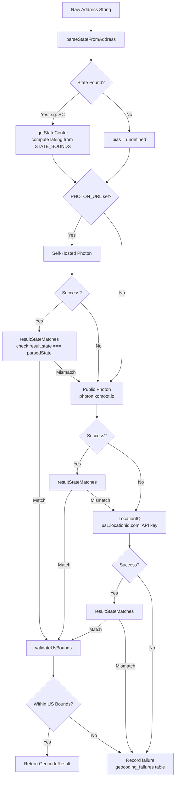

# Geocoding Cascade

## Flow

## Timeouts

| Service | Timeout | Rationale |
|---------|---------|-----------|
| Self-Hosted Photon | 5s | Local network, should be fast |
| Public Photon | 8s | External API, generous buffer |
| LocationIQ | 8s | External API, rate-limited |

**Self-hosted Photon is not currently deployed**, and the branch is guarded by
`PHOTON_URL` (`lib/utils/geocoding.ts`), which is unset, so requests start at
public Photon. `PHOTON_URL` is read from the process environment only: it is not
in the deployed container env allowlist (`worker/container.mjs`,
`worker/pipelineConfig.mjs`), so setting it on a Worker has no effect until it is
added there. It works for local dev (`.env.local`) and the benchmark scripts.

## State Validation

1. **Parse state** from address using `parseStateFromAddress()`:
   - Scans last comma-separated segment only (avoids street name false positives)
   - Checks for 2-letter abbreviations first, then full state names (including multi-word like "South Carolina")
   - Strips ZIP codes before matching full names

2. **Compute geographic bias** from `STATE_BOUNDS`:
   - If state is known, compute center point and pass as `lat`/`lon` to Photon
   - Keeps results in the Southeast (SC/GA region) instead of matching far-away states

3. **Validate result state** with `resultStateMatches()`:
   - If address specified a state and the geocoder can't determine its state, reject the result
   - If no state was parsed from the address, accept any result (permissive fallback)

## Key Files

| File | Purpose |
|------|---------|
| `lib/utils/geocoding.ts` | Orchestration: cascade, state parsing, US bounds validation |
| `lib/utils/geocoding/photon.ts` | Photon client (self-hosted + public), Zod schema, feature selection |
| `lib/utils/geocoding/locationIq.ts` | LocationIQ fallback client, Zod schema |
| `lib/utils/geocoding/stateConstants.ts` | STATE_NAME_TO_ABBREV (50 states + DC), STATE_BOUNDS, stateFromPhotonState() |
| `app/api/geocode/route.ts` | API endpoint, Zod-validated request body |
| `__tests__/lib/utils/geocoding.test.ts` | Cascade integration tests |
| `__tests__/lib/utils/geocoding/photon.test.ts` | Photon unit tests |
| `__tests__/lib/utils/geocoding/locationIq.test.ts` | LocationIQ unit tests |
| `__tests__/lib/utils/geocoding/stateConstants.test.ts` | State constants tests |
