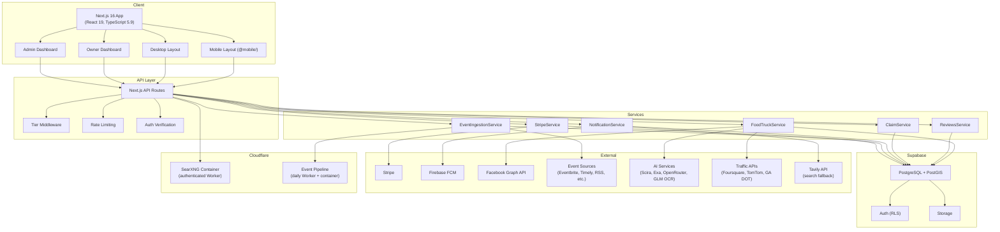

# Architecture Overview

## System Components



## Key Architectural Decisions

- **Next.js App Router** with parallel routes for mobile/desktop layouts
- **Supabase** for auth/storage/database with RLS enforced on all user-scoped tables
- **PostGIS** for geospatial queries (location-based truck discovery, radius filtering)
- **Feature-first organization** — services in `lib/services/`, API handlers in `lib/api/`
- **Tier-based access control** — middleware enforces free/starter/pro feature gates
- **Firebase FCM** for push notifications with tier-based routing
- **Stripe** for subscription management with webhook-driven lifecycle
- **Multi-source event ingestion** — 27 cities across SC/GA with 9 source adapters and vetting pipeline
- **AI pipeline** — Scira (research), Tavily (search API), SearXNG (self-hosted search), OpenRouter (parsing), GLM (OCR)
- **Self-hosted search** — SearXNG on Cloudflare Containers behind an authenticated Worker. Tavily API as parallel blended fallback (29% overlap, 13.6 avg results vs 9.8 solo)
- **Eventbrite rate limiting** — Pre-fetch dedup, 200 call/city cap, cross-city dedup by (name+date+rounded coords), configurable budget via env vars
- **Scheduled pipeline** — Daily event ingestion runs as a Cloudflare Worker + container

## Data Flow

```
User Request → Auth → Tier Check → API Route → Service → Supabase → Response
                                                              ↓
                                                    External APIs (Stripe, FCM, Facebook, AI)
```

## Deployment

- **CI/CD**: GitHub Actions (type-check, lint, test on PR)
- **Hosting**: Cloudflare Workers + Containers (production); Vercel retained only as a frozen rollback
- **Database**: Supabase (production)
- **Scheduled jobs**: Event ingestion runs daily on a Cloudflare Worker + container (`truckfull-pipeline-production`)
- **Search**: SearXNG on Cloudflare Containers, authenticated by the `truckfull-searxng-production` Worker
- **Code Quality**: Semgrep, CodeQL, ZAP, Striker, fast-check (Docker-based)

See ADRs for decision history.
